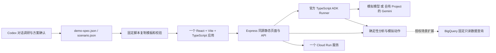

# 架构与边界

配置 V1–V4 向后兼容。V4 AI Demo 默认分栏，业务领域名称、指标、数据集和动作由已确认方案决定；看板不是固定客户页面。客户专用行为仅接 `client/demo-extension.tsx` 与 `server/demo-extension.ts` 静态边界。

assistant-ui 提供原生消息与工具状态，适配层仅处理受保护 ADK 事件、终态及取消；Markdown、引用、本地反馈和业务卡片复用固定组件。仅展示模型实际返回的公开思考摘要，不模拟内部思考。

服务端每轮读取并验证客户端上下文；生成中的轮次固定发送时快照，切换 Tab 不改变本轮含义。模拟操作重放校验状态、角色和版本，返回回执；历史经营快照不因模拟动作改变。

无数据库、Redis或队列；演示状态不是生产审计，角色切换不是生产授权。HTTP/SSE、请求超时、取消和平台限制独立于模型配额。请求结果不明不自动重发。

Cloud Run 模板包含源码构建、环境文件校验和默认 dry-run；不包含客户项目、服务账号密钥或自动 IAM 授权。真实数据接入、生产认证、持久化、触达、经营实验与 SLA 均需另行设计和验证。
